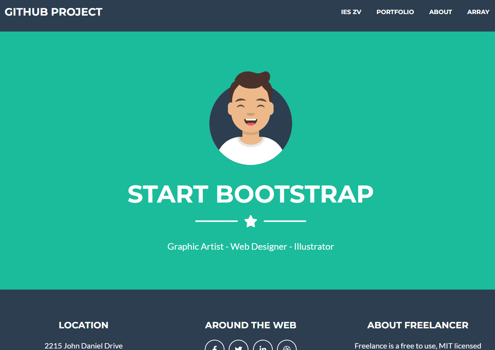

## Github Project

Proyecto Laravel con CRUD de **alumnos** y **profesores** (listado, ficha, alta, edición y borrado con validación),
además de las páginas de inicio, about, portfolio y array.

### Pasos a seguir para recuperar el proyecto en local

1. `git clone https://github.com/userName/repositoryName.git`
2. `composer install`
3. `cp .env.example .env`
4. `php artisan key:generate`
5. `php artisan migrate`
6. Dar permisos de escritura a `storage` y `bootstrap/cache`
7. `php artisan serve`
